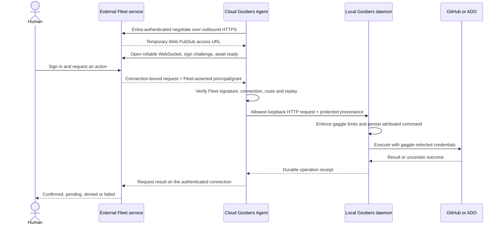

# Design: Fleet service authentication and delegated human access

> Status: draft — reconciled to the 2026-10-14 Fleet identity decision; no runtime delivery or live qualification claimed
> Area: fleet, authentication, authorization, HITL, audit
> Verified: 72156d7fe314c853fe38a2aaa408b75dc2388ab9 (2026-10-20)

Extends [fleet portal](fleet-portal.md) sections 5.2 and 7. Applies the
2026-10-14 deployment authority decision in
[interactive factory operations, section 4.1](https://github.com/Agent-Clubhouse/Goobers/blob/d0045f1ac196410bea852b2c2b0998031104d963/docs/design/interactive-factory-operations.md#41-deployment-authority-model)
([#6804](https://github.com/Agent-Clubhouse/Goobers/pull/6804)). Part of the
[HITL program](hitl-advanced-workflows-program.md), with stable `HAW-AUTH-*` task
IDs pending numbered backlog items. This draft is based directly on main; the
unmerged [#6807 snapshot](https://github.com/Agent-Clubhouse/Goobers/pull/6807)
is reference material, not a merge prerequisite or a claim of shipped behavior.

## 1. Decision and scope

**Fleet owns identity; Goobers is a trusted admin surface.** Where Fleet runs,
Fleet owns human sign-in, Entra/MSAL/MISE integration, sessions, membership and
per-user gaggle permissions. The Goobers dashboard/API behind it does not
authenticate humans, run a second OIDC/MSAL login flow, register another Entra
application for human login, or maintain a user directory.

For attribution and consent-class effects, Fleet supplies an opaque principal
reference and the grant or attestation for the effect. Goobers records these as
Fleet-asserted facts, unchanged, and binds them to the exact gaggle, action,
target, occurrence and idempotency key. It checks the local action/target ceiling,
provider credential selection, PR policy and execution safety rules. A human
approval or override requires an asserted human principal and the corresponding
effect grant; a service-only request cannot satisfy it. Goobers does not independently
verify the person, their Entra identity or their group membership.

This is a transport trust contract, not permission to expose an anonymous admin
API. The Agent authenticates Fleet's connection and signed request; the local
adapter preserves provenance and request integrity. An untrusted process cannot
manufacture Fleet facts by supplying headers or a browser-selected actor name.
Compromise of the trusted Fleet authority can forge those facts within the local
ceiling; section 12 makes that trade-off explicit.

Provider operations use existing **server-owned** gaggle credential bindings.
Interactive selection may intentionally differ from unattended workflow credentials,
or explicitly select the same binding. It adds neither per-user provider tokens
nor a second vault. A per-user provider OBO profile is an alternative for future
review, not the selected contract or a HITL prerequisite (section 12).

Standalone deployments retain today's trusted local/admin posture: tier-1
loopback trust or the existing instance-role OIDC seam. Optional direct browser
sign-in with per-gaggle human grants (`HAW-AUTH-009`) is a separate later track.
Existing trusted-local workflow starts and automation are not retrofitted with
Fleet login, human grants, or new Fleet service credentials. Only the new forwarded
HITL surface requires its Fleet provenance contract; failure cannot downgrade a
Fleet request to local trust.

Each forwarded request targets one gaggle. The instance exposes only explicit
local actions/targets and provider bindings; Fleet never widens them. Gaggle
scoping is an application boundary, not proof of hostile-tenant isolation on a
shared host, pod or credential store. Headless Fleet workload identity
(`HAW-AUTH-010`) also remains separate from human identity and provider credentials.

## 2. Current foundation and missing work

| Foundation | Reuse and boundary |
| --- | --- |
| [OIDC verifier](../../internal/oidcauth/oidcauth.go) | Existing standalone instance-role seam; no new daemon human OIDC flow is required for Fleet HITL. |
| [HTTP principal and authenticator](../../internal/httpapi/router.go) | Add typed Fleet-asserted principal/consent provenance through the service-authenticated adapter; do not treat it as a daemon-verified human token. |
| [Interactive policy in the unmerged snapshot](https://github.com/Agent-Clubhouse/Goobers/blob/fdda5e21426264e7f423ef2a4cedb01cbfdf1eee/internal/interactiveaccess/policy.go) | Reference for local action/target checks. Its direct-human heuristic must not become a Fleet identity requirement. |
| [Credential selector in that snapshot](https://github.com/Agent-Clubhouse/Goobers/blob/fdda5e21426264e7f423ef2a4cedb01cbfdf1eee/internal/interactiveaccess/credentials.go) | Reference for exact server-owned bindings and per-effect checks; not yet a shipped main-branch HITL adapter. |
| [Fleet protocol types](../../internal/fleet/types.go) and [connection signatures](../../internal/fleet/signature.go) | Enrollment/connection groundwork exists. Authenticating a service connection neither authenticates a human in Goobers nor authorizes an unbound effect. |
| [Interactive access snapshot reference](https://github.com/Agent-Clubhouse/Goobers/blob/fdda5e21426264e7f423ef2a4cedb01cbfdf1eee/docs/reference/interactive-access.md) | Historical implementation evidence; reconcile with the later authority decision before extracting runtime slices. |

The owner-supplied production Fleet/Agent contract in section 4 is a recorded
integration input, not evidence of a live test performed here. The older in-repo
connector types are not a substitute for that v2 contract. Neither main nor the
unmerged review snapshot is claimed to deliver the proposed general HITL adapter.
Existing Fleet diagnostics/export authorization is a separate contract. See the
[OIDC seam design](v1/38-auth-oidc-seam.md) and
[Fleet diagnostics reference](../guides/fleet-diagnostics-reference.md).
Before implementation, reconcile the security, instance, deployment and portal
requirements with the accepted scope. This draft does not silently approve itself
or the #6807 implementation snapshot.

## 3. Request flow and identity ownership



| Request provenance | Required fact and permitted use |
| --- | --- |
| Trusted local/admin | Existing deployment authentication and actor stamping; unchanged by this Fleet extension. |
| Fleet-asserted human | Authenticated Fleet transport plus an opaque principal reference and effect-specific grant; required for consent-class effects and bound to the exact occurrence. |
| Fleet service-only | Explicitly allowed forwarded service action; never evidence of human consent and never a substitute for a person's grant. |

Keep four identities separate: the Entra identity enrolling/running the Agent,
the local P-256 Agent registration identity, the Fleet signer/acting service,
and the opaque principal Fleet asserts for a particular action. The runtime
Entra bearer does not prove that the enrolling user initiated every forwarded request.
Fleet performs any human identity, group or consent verification it requires;
Goobers checks the source and binding of Fleet's asserted fact, not the human behind it.

Namespace opaque principal references by the trusted Fleet/tenant association.
Preserve the non-bearer grant/attestation exactly as received in the bounded audit
record, alongside its command binding and the transport-proof digest. The wire
contract must distinguish that auditable fact from bearer tokens or redeemable
credentials, which are never recorded. Reject an incompatible credential-bearing
grant rather than logging it as an actor field. Display labels are not authority.
Neither a raw browser-supplied reference nor a forwarded header creates trust.

## 4. Production Fleet/Agent integration baseline

This section records the project owner's supplied production contract. Preserve
the existing protocol's wire schema, signing algorithm and frame definitions;
the previous draft's direct inbound HTTPS option and invented JWT profile are
withdrawn. Proposed HITL additions are identified separately below.

### 4.1 Network and local daemon

- The cloud Agent initiates all Fleet network connections. Permit outbound TCP
  443 to the configured Fleet HTTPS origin, Microsoft Entra endpoints and the
  `wss://` Azure Web PubSub access URL returned by authenticated Fleet negotiation.
- Do not expose an inbound Fleet port. The Agent forwards to literal loopback
  HTTP, default `http://127.0.0.1:8085`, in the shared host/pod network namespace.
  Do not publish that port publicly or replace it with a service/ingress address.
- Permit the Fleet-returned Web PubSub destination through egress policy; reject
  non-`wss` URLs and unapproved endpoints. Its credential-bearing access URL is
  secret and must not appear in logs or durable run records.
- This is the Fleet control path's egress contract. Independently configured
  provider/model execution may require its own explicit outbound destinations.

### 4.2 One-time enrollment and protected state

1. Discover configuration at `GET /.well-known/goobers-fleet` on the chosen Fleet
   HTTPS origin and verify the intended Fleet identity.
2. Authenticate the enrolling user with Entra using the supported delegated flow.
3. Generate the Agent's local P-256 keypair and prove possession of its private
   key during registration using Fleet's registration/challenge protocol.
4. Persist registration identifiers, Fleet signing public key, Agent private key
   and authentication state in protected durable storage. Use the supported
   protected token cache; keep private keys and refresh material out of images,
   repository configuration, logs, model context and journals.

Restart or reconnection reuses this registration; it does not enroll again. A
replacement Agent must not silently share a live Agent's registration/keypair.
Existing fencing handles concurrent attempts, and replacement/recovery must be
explicit. Authentication expiry or required user interaction must surface as
unavailable/re-authentication-required, not trigger credential substitution.

Production enrollment and runtime currently use delegated Entra identity. A
headless service requires an explicitly supported workload-identity enrollment
and runtime flow with Fleet-side permissions, registration binding, credential
renewal and tests. An arbitrary client secret, managed identity or service token
cannot be substituted into the current user flow. OAuth
[client credentials](https://learn.microsoft.com/en-us/entra/identity-platform/v2-oauth2-client-creds-grant-flow)
is a possible future integration building block, not evidence of current support.

### 4.3 Runtime connection and presence

1. Obtain the supported Entra bearer token and call
   `POST /api/fleet/v2/agents/{instanceId}/negotiate` over HTTPS.
2. Use the returned temporary Web PubSub `wss://` access URL, currently valid
   for up to one hour, to open the reliable WebSocket.
3. Receive Fleet's challenge, sign it with the registered P-256 private key,
   and wait for `ready`. Dispatch no Fleet requests before that state.
4. Keep the connection alive using the Web PubSub reliable protocol and its
   acknowledgement/reconnect/resume behavior.
5. After handshake, send Entra-authenticated
   `POST /api/fleet/v2/agents/{instanceId}/presence` every 30 seconds.
   Fleet expires presence after 90 seconds. Transport keepalives and presence
   are separate obligations; neither is evidence that a requested operation ended.

If resume produces a different transport connection, discard the old session,
negotiate again, complete a new signed challenge and await `ready`. Do not carry
old connection authority into the replacement. Application handlers retain
request-idempotency evidence so reliable redelivery cannot duplicate an effect.

| Fleet control response | Required Agent behavior |
| --- | --- |
| `401`, `403`, `404` | End the current session, stop accepting work on it, and report the authentication/permission/registration failure. Recovery requires a valid supported state, not a fallback identity. |
| `409` | Treat the connection as superseded, discard its authority, and re-establish through negotiate/challenge/ready. |
| Transient disconnect | Use bounded reconnect/resume; preserve authority only if the reliable protocol retains the exact authenticated connection. |
| Revocation/fence | End that session's authority; any replacement must pass current Fleet authorization and registration checks. |

The one-hour access URL, 30-second presence cadence, 90-second presence expiry,
per-request delegation expiry and proposed HITL authorization leases are distinct
clocks. A live socket or presence heartbeat never extends delegation authority.

### 4.4 Agent-to-daemon trust boundary

The Agent verifies each Fleet delegation before forwarding an allowlisted route
to loopback. For the new HITL surface, a proposed daemon adapter must preserve
the Fleet-asserted principal/grant, service provenance and command scope through an authenticated
local Agent-to-daemon mechanism. It must not accept arbitrary forwarded identity
headers merely because a request came from loopback. Shared network namespace is
a connectivity requirement, not proof of a particular local process's identity.

Define the local proof and its installation/rotation together with the adapter:
either pass Fleet-verifiable evidence plus protected current-connection state, or
use a narrowly scoped local Agent credential and integrity-protected provenance.
Choose and qualify one before enabling HITL routes. The local credential must
grant only the registered forwarding surface, not generic daemon administration.
Strip caller-supplied provenance, never forward the Entra bearer or Web PubSub
access token, and reject redirects or arbitrary upstream URLs. Provider credentials
stay with the daemon's gaggle bindings. This adapter is proposed work, not a claim
about how the production Agent currently implements every loopback route.

## 5. Existing delegation and proposed HITL extensions

Fleet requests already contain a Fleet-signed delegation bound to the instance,
registration, exact connection, route, request ID, expiry and replay protections.
The Agent verifies it using the Fleet signing public key retained at enrollment
before forwarding. Implement against production-compatible fixtures; do not infer
the delegation's signing algorithm from the Agent's P-256 keypair or invent a
replacement JWT `typ`, claim vocabulary, JWKS endpoint or issuer/audience format.

The HITL adapter requires the following logical bindings. Some extend the existing
contract and must be negotiated/versioned with Fleet; names here are logical
requirements, not claims about deployed JSON field names.

| Binding | HITL requirement |
| --- | --- |
| Fleet/tenant association, instance, registration, exact connection | Match the pinned Fleet and active ready session; any old connection or registration is refused |
| Route and request ID | Bind the allowed method/path/query and request identity before dispatch |
| Expiry and replay identity | Verify signature/time and consume or reconcile request identity without repeating effects |
| Asserted principal kind and acting service | Distinguish a Fleet-asserted human/grant from service-only requests; no daemon human authentication |
| Asserted human and consent fact | Opaque Fleet-namespaced principal reference and effect grant/attestation, retained unchanged and independent of Agent enrollment identity |
| Gaggle, action and typed target | Exact locally configured gaggle, action and run/stage/occurrence or provider/repository/item |
| Mutation contents and idempotency key | Integrity-bind body bytes and command identity, so an approved request cannot be changed or executed twice |
| Decision and policy revision | Retain Fleet authorization evidence and an exact command scope for later revalidation |

Preserve deployed expiry semantics. Proposed HITL defaults, subject to Fleet
compatibility review, are a maximum 120-second delegation lifetime, 30 seconds of
clock skew and a 16 KiB delegation limit. Bound fields and opaque principal/grant objects;
reject malformed claims, unknown versions/actions, wildcards and algorithm
downgrades. These are not the Web PubSub access URL's lifetime or presence limits.

The Agent and daemon adapter must agree on route normalization and exact body
integrity. Reuse endpoint body limits; proposed v1 HITL forwarding rejects compressed
bodies, duplicate query keys, encoded path separators and ambiguous rewrites.
Compatibility fixtures must cover byte encodings before tightening existing routes.
Requests never select an upstream host: allowed targets resolve only to configured
literal loopback and allowlisted daemon routes.

No new `/api/v1/delegations:authorize` endpoint is assumed. Command reauthorization
is proposed protocol work to agree with Fleet over its authenticated control
channel or a documented Fleet HTTPS endpoint. Entra
[On-Behalf-Of](https://learn.microsoft.com/en-us/entra/identity-platform/v2-oauth2-on-behalf-of-flow)
and [OAuth token exchange](https://www.rfc-editor.org/info/rfc8693/) may inform
future adapters; neither replaces the production registration/connection handshake
or proves that app-only enrollment is supported today.

## 6. Gaggle policy and configuration

The following is **proposed syntax**, requiring schema/validator changes; it must
not be copied into current deployed configuration as if already supported.

```yaml
# instance.yaml (illustrative values)
api:
  fleetForwarding:
    associationRef: enrolled-fleet
    transport: agent-loopback
    daemonEndpoint: http://127.0.0.1:8085
    # Service provenance only; no new daemon human-login mode.
    maxDelegationSeconds: 120
    authorizationLeaseSeconds: 30

# Gaggle spec (existing credentials bindings still required)
spec:
  interactiveAccess:
    fleetForwarding:
      fleetRef: enrolled-fleet
      delegatedActions: [backlog.read, backlog.edit, run.intervene, run.restartStage]
      serviceActions: [] # New forwarded actions only; ordinary automation is unchanged.
    actions: [backlog.read, backlog.edit, run.intervene, run.restartStage]
    credentials:
      backlog: team-backlog-operator
      repositories:
        - repository: {provider: github, owner: acme, name: web}
          credentialRef: team-code-author
    sourceWrites: {mode: pull-request}
```

`associationRef` identifies protected existing enrollment, not an arbitrary URL
that silently enrolls an instance. This example adds no inbound Fleet endpoint.
The Agent owns its Entra authentication state and negotiated connection; the daemon
accepts only the protected local forwarding adapter. Trust changes require local
administration; delegated callers cannot edit their own trust or capability ceiling.

For a forwarded effect, effective authority is the intersection of the authenticated
Fleet service/association, its asserted grant, the instance trust ceiling, the gaggle
action/target ceiling, operation constraints and the selected provider's permissions.
There is no daemon user lookup, per-user local grant or human token validation.
This is separate from the unchanged trusted-local/admin entry path; a rejected
Fleet request cannot switch paths to acquire more authority.

`serviceActions` defaults empty for this new forwarded surface. It does not
remove or reauthorize existing trusted-local workflow starts. An allowed background
Fleet action must remain within local limits. Human-gate approval/override and any
other consent-class effect require the Fleet-asserted principal plus the grant for
that exact effect and occurrence. Split suboperations of broad `run.intervene`
explicitly; a service-only grant must not satisfy human consent.

Omitting the interactive write/session opt-in keeps those new capabilities disabled;
existing monitoring policy is unchanged. The new forwarded surface additionally
requires configured service provenance. Neither implies provider access: credentials
are the explicit gaggle bindings, resolved independently per provider/repository.
A missing binding never falls back to the Fleet runtime identity, another repository,
an enrolling user's token, or a later OBO profile.

## 7. Replay, retries, revocation and outages

The Agent durably reserves a pending forwarding record keyed by Fleet/registration/
exact connection/request ID and the production delegation replay identity before
forwarding. The daemon atomically admits the protected provenance and command
idempotency key with its durable receipt before effects. These are two process
boundaries, not a distributed atomic transaction. After a crash between them, the
Agent reconciles the same command identity with the daemon; a repeated forwarding
attempt returns the existing receipt or performs first admission, never a second
execution. An expired or fenced connection requires fresh authorization before
reconciliation, without changing the original command identity. Reads also reserve
a bounded replay record before dispatch. Consumed IDs cannot authorize new work.
Reliable redelivery of the same request on the same valid connection may return an
existing matching receipt after current read authorization, but never re-run the
handler. A new connection requires a new valid delegation; command idempotency
remains stable across connections to prevent repeating a previously accepted effect.
An application retry obtains a new delegation and reuses that idempotency key.
Only a currently authorized matching asserted principal, target and request may
retrieve the existing receipt; the same key with a different payload returns a conflict.

Retain replay IDs through expiry plus skew; a registered startup and periodic
pruner removes expired entries. Initial hard cap: 100,000 active IDs per instance,
with per-service admission rate limits. At capacity, reject new work with a bounded
retry response; never evict an unexpired ID to make room. Existing operation receipt
retention remains separate: expiring a token cannot erase an operation's evidence.

Absent a received fence/revocation, Fleet membership changes may leave an issued
delegation usable through its validity window (proposed HITL cap: 120 seconds
plus skew). Effect authorization uses a decision lease of at most 30 seconds,
anchored to the Fleet-signed decision time and bounded by delegation expiry. Receiving or
replaying an older delegation does not restart that clock. Admission may retain a
receipt under the longer delegation window, but the first effect must renew an
already-expired decision lease; a stale admission cannot extend effect authority.
Revalidation asks Fleet for a new signed decision for the same asserted principal,
command and exact scope;
it must not replay the original human bearer token. Received local revocation is
applied before the next effect; fleet policy revocation is bounded by the decision
lease plus skew, not claimed instantaneous. Fleet-side session invalidation must
invalidate associated command authorization as well.

Persist revocations/policy generations and registration generation across restarts.
An explicit Fleet fence invalidates leases derived from that connection before
new effects; an old lease cannot override the fence. A transient disconnect does
not itself prove that work stopped, and cannot extend an already issued lease.
If no fresh decision can be obtained, pause before new writes or further sensitive
reads. Already submitted effects are reconciled and reported; they are not described
as rolled back. Receipt reads also require current read permission. Automatic
workflows with independent automation authority continue during fleet outages.

Use the Fleet signing public key persisted during enrollment. Key rotation must
follow an authenticated, production-supported transition anchored in existing
trust, or explicit re-enrollment/administrative recovery. Do not silently adopt
new keys from a token-provided URL or untrusted rediscovery. Define overlap and
revocation fixtures with Fleet before enabling the extension; unknown keys fail
closed. Local trust revocation overrides all retained key/session state.

Fleet cancellation frames initiate a cancellation request, not a terminal result.
The Agent forwards a validated cancellation to the daemon, retains the operation
receipt and reports confirmed cancellation only when Agent/daemon evidence shows
that the work stopped. Closing/fencing a socket, losing presence, or a timed-out
acknowledgement leaves cancellation pending or outcome unknown. Recovery reconciles
the durable request/run before any new execution; existing parent-child cancellation
rules still apply. Revocation may prevent acknowledgement delivery without proving
that the work did or did not stop.

## 8. Queued work, agent sessions and human decisions

Persist a typed authority record alongside each accepted durable command: Fleet-asserted
principal and non-bearer effect grant, acting service, session reference, trust and policy generations, command
digest, admitted action/target ceiling, fleet decision ID and local credential refs.
Keep bearer/delegation tokens out of journals, model context and Temporal history.
Token expiration does not erase the command or cancel already accepted work by itself.

At dispatch, recovery, each session turn, and before provider effects, obtain a fresh
authorization lease for the retained command, then intersect it with current local
policy. Renewal cannot change the asserted principal, replace a required human consent
fact, or widen accepted scope. It renews Fleet authority; it is not human
reauthentication in the daemon. Long work can
continue after the browser disconnects while the fleet retains the command grant;
session invalidation or permission removal blocks renewal. There is no blanket
service grant that lets forwarded work bypass Fleet revocation of its command grant.

Lease enforcement must reach the executor: remote workers and provider brokers
refuse new effects after their lease expires. A running subprocess that cannot
enforce this bound must be stopped and its effects reconciled; that execution
shape cannot advertise fleet writes until the boundary is qualified. Revocation
cannot recall a request already accepted by GitHub/ADO. Stop accepting new effects,
retain uncertain receipts and use a separately limited reconciliation capability.

Each contributor to a shared session submits a newly authorized message. A session
creator's grant does not authorize subsequent users. Generated children retain the
originating authority ceiling; no child can replace it with fleet service authority.
Human-gate confirmation binds the exact occurrence and action digest. A renewed
execution lease preserves that recorded decision; it does not fabricate a new one.

## 9. Audit, portal behavior and operations

Record Fleet/service identity, opaque asserted principal and effect grant where
present, command and
decision IDs, target gaggle, action, admitted/current policy revisions, provider
credential reference, and confirmed/uncertain outcome. Avoid logging raw tokens,
group lists, request bodies or secrets merely to diagnose authentication failures.
Cache provider projections by effective credential visibility and gaggle as today;
Fleet reauthorization applies before returning cached data. If a future OBO
profile is selected, cache visibility must also partition by tenant, user and
provider authorization; shared server-credential caches cannot be reused as-is.

The portal displays the acting human or service, and distinguishes authorization
denied, authorization temporarily unavailable, queued, executing and effect unknown.
For proposed daemon HITL operation responses (separate from the Fleet control
responses in section 4.3), unauthenticated requests return 401; scope denials return
403 without target enumeration; conflicting retries return 409; exhausted replay admission returns
429; unavailable authorization dependencies return 503. Errors contain correlation
IDs, not token contents. Missing delegated capability never looks like a working
write control. User-facing data streams reauthorize within the proposed lease
bound. The Agent transport itself follows the reliable Web PubSub resume and
presence contract in section 4.3; a new transport connection requires a new
handshake and fresh request delegations.

Fleet mode owns login/logout and CSRF/session protection at the external service.
Cookies used by that service must not become implicit authentication on the instance.
No instance browser sign-in UI is required for Fleet HITL or default trusted-local
HITL. Optional direct browser login is a later independent track, not a prerequisite.

Operational records (replay entries, command authority, enrollment/revocation state)
are durable Goobers state with versioned schemas and bounded retention. User
directories and strategic objectives remain external/source-owned. On rollback,
an older binary must reject unknown forwarding/authority versions, not downgrade to
local trust. Trust removal pauses affected delegated work; a local administrator
can cancel it through the existing explicitly authenticated administration path.

## 10. Delivery slices and acceptance

These are Fleet transport/provenance slices within HITL, not a fifth product stream.
Implement the provenance/queue contract before advertising the new forwarded
HITL write surface. Service authentication alone does not supply consent facts.
This sequencing does not gate existing trusted-local operations or require human
login in the daemon.

| Task | Deliverable and required evidence |
| --- | --- |
| HAW-AUTH-001 | Apply the 10-14 deployment authority decision; amend requirements, proposed schemas and route/action taxonomy. Test unchanged trusted-local behavior, omitted interactive opt-in and refusal to downgrade failed Fleet provenance to local trust. |
| HAW-AUTH-002 | Typed Fleet-asserted principal/consent facts and protected Agent-to-daemon provenance. Test exact retention and occurrence binding, absent human grant, service-only consent attempts, forged headers and enrollment-user substitution. No daemon human OIDC/MSAL flow, directory or second login app; retain loopback-only forwarding. |
| HAW-AUTH-003 | Production Fleet v2 protocol fixtures: one-time P-256 enrollment/possession, protected state, negotiate, reliable Web PubSub challenge/ready, 30-second presence and 90-second expiry. Verify delegation against exact registration/connection/route/request; test key transitions, substitution and replay. |
| HAW-AUTH-004 | Durable replay and idempotent admission. Crash/restart, duplicate concurrent requests, changed retry payload, capacity exhaustion and registered expiry pruning must prove bounded state and no duplicate effect. |
| HAW-AUTH-005 | Fleet assertion-to-local-ceiling adapter and command lease protocol. Prove no user lookup, no ceiling escalation, unchanged local/admin operations, explicit provider bindings, fixed decision-time lease expiry and outage denial. |
| HAW-AUTH-006 | Queue/session/restart/child authority propagation and worker effect enforcement. Test human revocation, worker restart, lease expiry, uncertain effects, cancellation frames, lost acknowledgements and socket closure without falsely reporting stopped work. Unsupported executors remain disabled. |
| HAW-AUTH-007 | Audit, capability discovery, portal states, stream reauthorization, operator setup/rotation/rollback docs and secret scrubbing. Record the asserted principal/grant plus acting service and actual provider identity on every tested consent-class mutation. |
| HAW-AUTH-008 | End-to-end qualification against production-compatible Fleet and delegated Entra identity: egress-only Agent, shared network namespace, protected persistence, same-connection resume, changed-connection renegotiation, 401/403/404 termination, 409 supersession, presence expiry and two-gaggle isolation. Run fakes plus explicitly documented live qualification. |
| HAW-AUTH-009 | Optional standalone browser sign-in, separately designed and approved: login/callback/session/token lifecycle and per-gaggle human grants. Not a dependency for either Fleet HITL or default trusted-local HITL. |
| HAW-AUTH-010 | Separate headless-cloud prerequisite: agree and implement supported workload-identity enrollment/runtime with Fleet, explicit service permissions, registration proof, rotation and audit. Until qualified, no arbitrary service credential may replace delegated Entra authentication. |

Implementation PRs must install production callers for renewal/pruning/revocation,
not just interfaces and unit tests. Required review evidence includes a protocol
fixture pack usable by an independently implemented external service. Run the
same authorization vectors against supported local/Temporal execution shapes;
unqualified shapes report unavailable, never silently use automation credentials.

## 11. Deferred extensions and review choices

V1 uses one fleet per instance, one acting service per delegation, exact gaggle
scope, bounded validity, explicit service actions and server-owned write credentials.
Nested delegation, cross-fleet trust, arbitrary OAuth token exchange, provider
OBO profiles and customer-provided signing algorithms are future extensions.
Section 12 compares the OBO alternative without selecting or implementing it.
Headless workload identity is separately tracked by HAW-AUTH-010;
its absence is a deployment blocker for unattended cloud-service enrollment, not
a reason to substitute credentials. Direct inbound Fleet access is out of scope.
Broader fleet groups and routing remain owned by the fleet design.

Review the proposed 120-second delegation and 30-second decision lease defaults
against expected effect volume and revocation needs. Prefer signed lease reuse
within the bound to a Fleet authorization request per tool call. The production
transport and enrollment/runtime identity are fixed by section 4. Remaining integration
choices are the protected local provenance mechanism and Fleet-compatible HITL
authorization renewal/schema extensions. No live compatibility qualification is
claimed by this documentation change.

## 12. Provider execution profiles: server-owned credentials versus per-user OBO

### 12.1 Selected contract and alternative

**Profile A is selected by the 10-14 decision:** Fleet asserts the initiating
principal and effect grant; Goobers executes with an explicitly selected,
server-owned provider binding. Human attribution and the provider's executing
identity are different facts. This fits unattended work and interactive actions
that deliberately use a team's execution authority. A Fleet grant alone never
selects a credential or expands its local target ceiling.

**Profile B is a future, explicitly opted-in per-user provider profile:** a
trusted provider broker obtains a delegated provider token for the initiating
user, then executes within both that user's provider access and the unchanged
local ceiling. Human sign-in still belongs to Fleet. Goobers must not silently
become a human identity provider, accept browser-supplied provider tokens, or
fall back from a failed B request to A's broader credentials. Selecting B would
require a separate approved design and provider-by-provider qualification.

Microsoft's OBO protocol requires a user access token addressed to the
middle-tier application, that application's credentials, downstream delegated
permissions and consent. An opaque Fleet principal/grant is not an OBO assertion,
and the Agent's enrollment token is not a substitute for the initiating user's
authority. A middle tier cannot redeem a token addressed to another API.
See [Microsoft's OBO protocol](https://learn.microsoft.com/en-us/entra/identity-platform/v2-oauth2-on-behalf-of-flow).
Azure DevOps documents an Entra delegated integration path distinct from
service-principal/managed-identity access; each target organization and resource
must be qualified, not inferred from Fleet login.
See [Azure DevOps Entra OAuth](https://learn.microsoft.com/en-us/azure/devops/integrate/get-started/authentication/entra-oauth?view=azure-devops).

Here “OBO profile” describes the desired user-bound execution semantics, not a
universal token-exchange wire protocol. GitHub's corresponding option uses an
authorized GitHub App user token, constrained by both user and app access;
installation tokens instead act as the installation. It needs its own consent,
identity association and adapter rather than exchanging an Entra token for GitHub.
See [GitHub user authentication](https://docs.github.com/en/apps/creating-github-apps/authenticating-with-a-github-app/authenticating-with-a-github-app-on-behalf-of-a-user).

### 12.2 Security and operations comparison

These are design consequences of the two proposed execution profiles, not claims
that an OBO implementation or isolated multi-tenant deployment has shipped.

| Dimension | A — server-owned credentials + Fleet-asserted principals | B — per-user provider OBO profile |
| --- | --- | --- |
| Trust boundary | Fleet is authoritative for the human fact and grant. Goobers authenticates their delivery and enforces local ceilings; the provider sees the selected server identity, whose rights may exceed the human's own provider account. A compromised Fleet signer can impersonate users inside every association/ceiling it controls. | Fleet remains authoritative for human sign-in. A trusted broker additionally establishes the association to the provider user, validates its own incoming token audience, and obtains delegated resource authority. The provider enforces that user's access. This narrows execution authority but does not make Fleet or broker compromise harmless. |
| Token custody in pods | No initiating-user provider token is introduced. Agent enrollment/refresh state and its private key remain in protected Agent storage; server provider secrets remain in the existing resolver/broker custody. A qualified executor may receive only its selected, scoped short-lived credential if necessary, never the Fleet runtime token or the whole resolver store. | User assertions, refresh material and confidential-client keys remain in a tenant-isolated trusted broker, outside workload pods. Prefer effect brokerage so pods receive only command-bound capabilities. If a provider token must enter a pod, use a scoped short-lived token in a protected ephemeral mount/agent, with explicit audience/egress limits and cleanup. It is a bearer credential, not an enforcement mechanism for Goobers' narrower command scope. |
| Revocation | Fleet command/session revocation prevents new effects within the decision-lease bound. It does not revoke the shared provider credential, undo an accepted provider request or stop separately authorized automation. Removing/rotating that binding can affect every command that shares it. | Both Fleet authority and provider-user/consent authority must remain valid. Stop renewal and new effects on either loss; handle provider denial or interaction-required responses through Fleet. Token-cache deletion or browser logout is not proof that an already-issued token or in-flight write was revoked. Long-running work may pause for renewed user interaction. |
| Audit | Preserve Fleet principal/grant and service provenance, command/occurrence, actual provider identity/binding, policy revisions and effect receipt. Provider logs generally attribute the write to that credential's identity; Goobers supplies the separate human attribution. Never label it a provider-verified human action. | Preserve the same command evidence plus the broker-attested provider-user association and profile/consent reference. Provider-native logs can add user/app attribution where the provider supports it; that does not replace the local consent/occurrence record. Never persist access tokens as audit evidence. |
| Multi-tenant blast radius | A shared server credential or resolver can span users, gaggles or tenants. Local gaggle checks do not contain a stolen credential used directly against the provider. Separate bindings, stores/brokers and deployments for hostile tenants; minimize installation/repository scopes and credential-sharing domains. | A stolen user token is limited by that token's user/resource authority, which can still span many repositories. A shared broker/cache compromise can expose many users' refresh grants, while a cross-tenant cache-key or principal-association bug can return the wrong user's token. Isolate broker storage and keys by tenant; bind authorization/cache keys to tenant, issuer, user, client, provider audience and allowed target. |
| Availability and policy fit | Continues team-authorized execution without requiring the initiator to maintain provider login; Fleet leases still gate delegated commands. Appropriate when the team intentionally grants the server identity that authority. | Appropriate when effects must also be constrained by each human's provider account. Adds consent, token lifecycle, claims-challenge handling and user departure dependencies. It cannot silently convert unfinished user work into unattended service work. |

In both profiles, a sidecar or second container in the same pod is not a hostile
tenant boundary. Keep long-lived secrets out of untrusted repository tools, model
context, environment dumps, journals, Temporal history, images and caches. Scope
credential mounts to the trusted component that needs them. A compromised worker
holding a provider bearer can bypass the Goobers API; use a command-scoped effect
broker when bounded revocation and exact target enforcement are required. Do not
advertise those guarantees for an executor shape that cannot enforce them.

Refresh credentials require their own protected lifecycle; Microsoft documents
that they are not inherently restricted to one resource or tenant, and sign-out
is not equivalent to universal token revocation. A future B profile must specify
actual issuer/provider behavior and test revocation, rather than assuming instant
revocation from a token TTL or Fleet logout.
See [refresh-token behavior](https://learn.microsoft.com/en-us/entra/identity-platform/refresh-tokens)
and [resource ownership of access tokens](https://learn.microsoft.com/en-us/entra/identity-platform/access-tokens).

### 12.3 Acceptance gate for any later OBO profile

Before choosing B, approve a provider-specific broker contract covering: the
trusted Fleet-to-provider-user association; tenant and audience validation; consent
and claims challenges; protected cache/refresh custody; exact target and command
binding; provider denial, departure and revocation; audit correlation; and
recovery without changing principal or credential profile. Test two tenants with
colliding display names and opaque subject values, cross-user cache substitution,
stolen workload capability, expired/revoked grants, and an uncertain submitted
write. Never use display names or a bare email address as the association key.

The profile is fixed in the accepted command and inherited by children. Renewal
may narrow scope but cannot switch A/B, actor, tenant or provider binding. A profile
change requires a new explicitly authorized command and reconciliation of any old
uncertain effects. Existing trusted-local operations and the selected A contract
remain usable without implementing B, HAW-AUTH-009 or HAW-AUTH-010.
